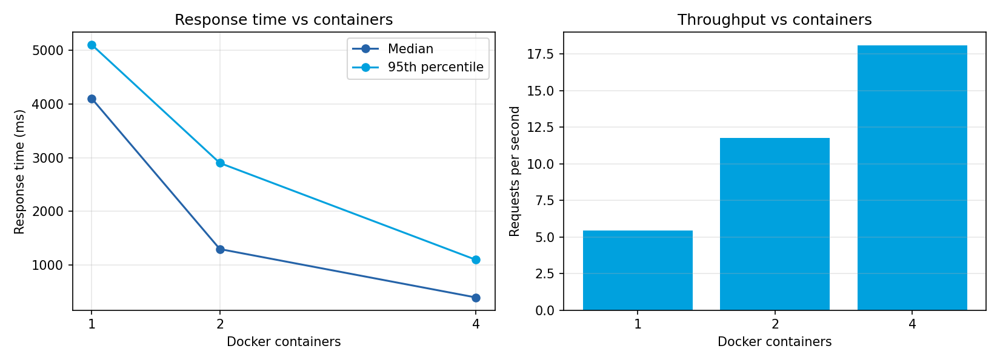

# Rwanda Weather MLOps Pipeline

An end-to-end machine learning pipeline that **classifies the weather in a photo** (rain, fog/smog,
lightning, hail or rainbow). It covers data acquisition, preprocessing, model training and evaluation,
a prediction API, bulk upload with retraining, a monitoring dashboard, cloud deployment on Azure and
load testing with Locust.

| | |
|---|---|
| **Live app (Azure Container Apps)** | https://rwanda-weather.gentlemeadow-e55c79cc.southafricanorth.azurecontainerapps.io |
| **API docs (Swagger)** | https://rwanda-weather.gentlemeadow-e55c79cc.southafricanorth.azurecontainerapps.io/docs |
| **Video demo (YouTube)** | https://youtu.be/YOUR-VIDEO-ID |
| **Dataset** | [Weather Image Recognition, Kaggle](https://www.kaggle.com/datasets/jehanbhathena/weather-dataset) |
| **Notebook** | [`notebook/rwanda_weather_mlops.ipynb`](notebook/rwanda_weather_mlops.ipynb) |

---

## 1. Project description

My Introduction to Machine Learning summative predicted next-day rainfall in Rwanda from tabular climate
data. This project carries that use case over to **images**. Given a photo of the sky or surroundings, the
model names the weather condition, choosing from five classes that matter in Rwanda:

| Class | Why it matters in Rwanda |
|---|---|
| `rain` | Main driver of floods and landslides in the two rainy seasons |
| `fogsmog` | Low visibility on hilly roads, especially mornings in Kigali and the Northern Province |
| `lightning` | Rwanda has one of the highest lightning-strike rates in the world |
| `hail` | Damages crops such as tea, coffee and beans |
| `rainbow` | Clearing weather after rain (positive class) |

**Model:** MobileNetV2 pretrained on ImageNet (transfer learning) with a regularised custom head
(Dropout 0.3, Dense 128 with L2 1e-4). It is trained in two phases: first the frozen base with Adam at 1e-3,
then the top 30 layers are fine-tuned at 1e-5. Training uses EarlyStopping, ReduceLROnPlateau, class weights
and data augmentation.

**Results on 496 held-out test images:**

| Accuracy | Precision (macro) | Recall (macro) | F1 (macro) | ROC-AUC | Loss |
|---:|---:|---:|---:|---:|---:|
| 97.6% | 97.9% | 97.4% | 97.7% | 99.9% | 0.093 |

### Features of the app

| Requirement | Where it is |
|---|---|
| Predict one image | **Classify a photo** page: drag in a photo or click a test photo the model has never seen. Test photos show whether the prediction matches the true label. |
| Visualisations and interpretations | **Explore the data** page: class balance, brightness and contrast, colour and saturation, per-class F1 and the confusion matrix, each with an interpretation |
| Bulk upload | **Add data and retrain** page: many images with a chosen class, or a `.zip` with one folder per class |
| Retraining trigger | A **Retrain now** button, plus an **automatic trigger** once 50 new images are waiting (`RETRAIN_THRESHOLD`) |
| Model uptime and monitoring | Live uptime clock in the sidebar and the **Model health** page: status, uptime, model version, predictions served, latency, test scores and retraining history |

---

## 2. How the pipeline works

```
 Kaggle dataset ──► notebook: acquisition, feature extraction, cleaning, resizing, split
                          │
                          ▼
            train MobileNetV2 (2 phases) ──► evaluate (7 metrics) ──► models/weather_model.h5
                                                                            │
 Browser / Locust ──► FastAPI (api/main.py) ──► /predict ─────► src/prediction.py (model kept in memory)
                          │
                          ├─► /upload ──► src/preprocessing.py (EXIF fix, RGB, 224x224) ──► SQLite DB + data/uploads/
                          │
                          └─► /retrain (button, or automatic at 50 new images)
                                   └─► src/model.py: load the CURRENT .h5 as the pretrained model,
                                       fine-tune on new + old images, evaluate on the same test set,
                                       promote only if macro F1 is not worse, then hot-reload it
```

### Retraining in detail
1. **Upload and save to the database.** Each uploaded image, or each image inside a zip, is checked
   (file type, size, readable), cleaned and resized to 224x224, then stored in the SQLite `uploads` table:
   the image bytes as a BLOB, plus its label and a `used_in_training` flag.
2. **Preprocessing.** Uploaded images go through the same steps as in the notebook: EXIF rotation, RGB
   conversion and resizing to 224x224. During training they also get the same augmentation (flip,
   rotation, zoom, contrast). Pixel normalisation to [-1, 1] happens inside the model, so training and
   production can never use different preprocessing.
3. **Retraining from the custom model.** The current `weather_model.h5`, which is my own trained model and
   not a fresh ImageNet model, is loaded as the pretrained starting point. It is fine-tuned on the new images
   plus a replay sample of 120 old images per class, so it does not forget what it already knows. This uses
   a low learning rate (1e-5), class weights and early stopping on a stratified validation split.
4. **Evaluation and promotion.** The retrained model is scored on the same untouched test set. It replaces
   the live model only if its macro F1 is at least as good, within 0.01. The old model is archived in
   `models/versions/`. The new model is hot-swapped into the running API, so no restart is needed.

---

## 3. Repository structure

```
rwanda-weather-mlops/
├── README.md
├── notebook/
│   └── rwanda_weather_mlops.ipynb   # acquisition, preprocessing, feature analysis, training, evaluation, prediction
├── src/
│   ├── preprocessing.py             # image cleaning/resizing, augmentation, datasets
│   ├── model.py                     # model architecture, evaluation, retraining (+ CLI)
│   └── prediction.py                # loads the model once, predicts one image
├── api/
│   ├── main.py                      # FastAPI: /predict /upload /retrain /health /metrics /insights ...
│   ├── db.py                        # SQLite: uploads (image BLOBs), retraining runs, prediction log
│   └── static/index.html            # web dashboard (UI)
├── data/
│   ├── train/                       # 1,981 images, one folder per class
│   ├── test/                        # 496 images, never used for training
│   └── retrain_demo/                # 100 held-back images (20 per class) for the retraining demo
├── models/
│   ├── weather_model.h5             # trained model
│   ├── class_names.json, metrics.json, insights.json
├── locust/                          # load test + scripts for local Docker and Azure experiments
├── results/                         # Locust results (CSV, tables, charts)
├── deploy/                          # Azure deployment script, Nginx load balancer config
├── Dockerfile
└── docker-compose.yml
```

---

## 4. Setup

### Option A: run with Python (Windows PowerShell)
Needs Python 3.11 to 3.13.

```powershell
git clone https://github.com/teniolaiji/rwanda-weather-mlops.git
cd rwanda-weather-mlops
python -m venv .venv
.\.venv\Scripts\Activate.ps1
pip install -r requirements.txt
uvicorn api.main:app --host 0.0.0.0 --port 8000
```
Open http://localhost:8000 for the dashboard and http://localhost:8000/docs for the API docs. On macOS
or Linux, activate the environment with `source .venv/bin/activate`.

### Option B: run with Docker
```powershell
docker build -t rwanda-weather-api .
docker run -p 8000:8000 rwanda-weather-api
```

### Option C: several containers behind a load balancer
```powershell
docker compose up -d --build --scale api=3
```
Nginx listens on http://localhost:8080 and spreads requests across the containers. Each response says
which container answered it.

### Re-running the notebook
Open `notebook/rwanda_weather_mlops.ipynb` in Jupyter or Google Colab and run all cells. It downloads the
dataset with `kagglehub`, rebuilds `data/` and `models/` and zips them for download.

### Retraining from the command line (optional)
```powershell
python -m src.model --retrain data/retrain_demo
```

### Deploying to Azure Container Apps
Needs Docker Desktop, a Docker Hub account and the Azure CLI (`az login`).
```powershell
powershell -ExecutionPolicy Bypass -File deploy\azure_deploy.ps1 -DockerUser <docker-hub-username>
```
The script builds and pushes the image, creates the resource group and Container App (2 vCPU, 4 GiB) and
prints the public URL. Use `-SkipBuild` if the image is already on Docker Hub. Two helper scripts:
`deploy\check_live.ps1` (smoke test: health, metrics and one prediction per class) and `deploy\reset_live.ps1`
(fresh container, back to model v1 with an empty database).

---

## 5. Using the app

1. **Predict:** on *Classify a photo*, drag in a weather photo or click one of the test photos. You get the
   predicted class, confidence for every class, response time and which container answered.
2. **Upload data:** on *Add data and retrain*, choose a class and select several images, or upload a zip
   with one folder per class. To try it, upload images from `data/retrain_demo/`, which the model has never
   seen. To make a zip of all 100 images:
   ```powershell
   Compress-Archive -Path data\retrain_demo\* -DestinationPath retrain_demo.zip
   ```
3. **Retrain:** press **Retrain now**. The log shows each step live. When it finishes, a before and after
   table shows the test scores and whether the new version was put into use.
4. **Monitor:** *Model health* shows uptime, model version, predictions served, latency and the retraining
   history.

---

## 6. Load testing results (Locust)

`locust/locustfile.py` simulates users who each send real test photos to `/predict`, waiting 0.5 to 1.5 s
between requests, and occasionally call `/health`. Every run uses **30 concurrent users for 60 seconds**.
The only thing that changes is the number of Docker containers.

Each Azure Container Apps replica is one Docker container (2 vCPU, 4 GiB) running the image built from
the `Dockerfile`. Azure's built-in load balancer spreads requests across the replicas. The experiment
scales the app to 1, 2 and then 4 replicas and runs the same flood against each:
```powershell
powershell -ExecutionPolicy Bypass -File locust\run_cloud_experiments.ps1
```

**Results for `/predict` (30 users, 60 s per run, Azure South Africa North):**

| Containers | Requests | Requests/s | Avg (ms) | Median (ms) | p95 (ms) | p99 (ms) | Max (ms) | Failures |
|---:|---:|---:|---:|---:|---:|---:|---:|---:|
| 1 | 321 | 5.4 | 4170 | 4100 | 5100 | 5500 | 6440 | 0.0% |
| 2 | 699 | 11.8 | 1366 | 1300 | 2900 | 3200 | 3379 | 0.0% |
| 4 | 1,058 | 18.1 | 506 | 400 | 1100 | 1600 | 1779 | 0.0% |



**How the requests were shared (from the `container` field in each response):**

| Containers | Predictions answered by each container |
|---:|---|
| 2 | 358 / 343 (51% / 49%) |
| 4 | 281 / 271 / 264 / 259 (26% / 25% / 25% / 24%) |

### What the results show
- **One container is overloaded.** Thirty users wanting about 30 requests per second is far more than one
  container can handle (about 5 per second), so requests queue up. The median response time is 4.1 s, even
  though the model itself needs only about 130 ms per image.
- **Adding containers cuts latency almost in proportion.** With 2 containers the median falls to 1.3 s (3x
  faster), and with 4 it falls to 0.4 s (10x faster than one). p95 drops from 5.1 s to 1.1 s.
- **Throughput scales close to linearly:** 5.4, then 11.8, then 18.1 requests per second (3.4x with 4
  containers), because users who get faster answers send their next request sooner.
- **The load is shared evenly:** each container answered about 1/N of the predictions.
- **No request failed** in any run, so the API degrades gracefully under overload: it slows down but stays correct.
- The `/health` endpoint (no model inference) stays fast throughout. The bottleneck is CPU-bound
  inference, so scaling out containers is the right fix. Autoscaling on concurrent requests would do it
  automatically.

### Running the flood yourself
```powershell
python -m locust -f locust/locustfile.py --host https://rwanda-weather.gentlemeadow-e55c79cc.southafricanorth.azurecontainerapps.io
```
Then open http://localhost:8089, choose the number of users and watch response times live. The same
experiment can also be run locally with Docker Compose and Nginx (1, 2 and 4 containers) using
`powershell -ExecutionPolicy Bypass -File locust\run_experiments.ps1`.

---

## 7. Notes and limitations
- Uploads, the SQLite database and retrained models live on the container's local disk. On Azure, the
  app runs as **one replica** for the demo, so every upload and retrain goes to the same container. A
  restart resets the app to the model in the Docker image. A production version would keep data in Azure
  Blob Storage and a managed database, and keep models in a registry.
- Load tests are run separately from retraining, because retraining uses all the CPU of its container.


